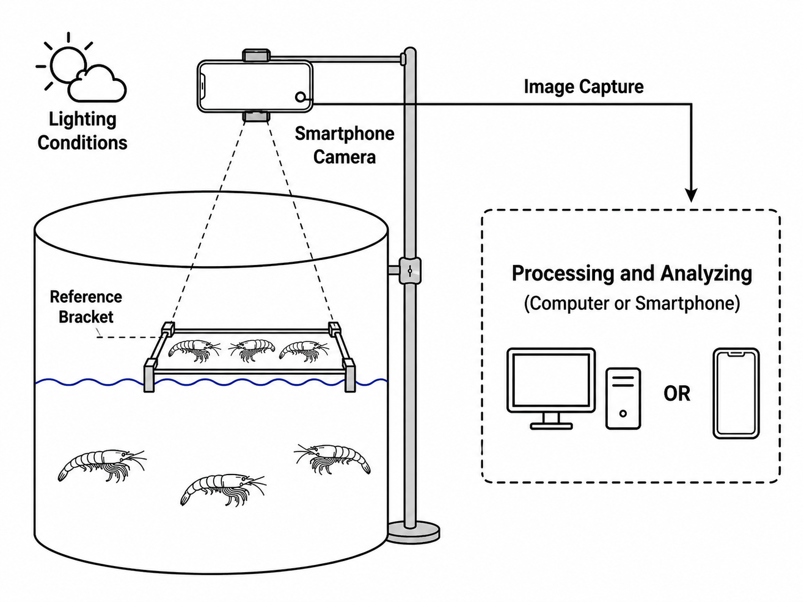
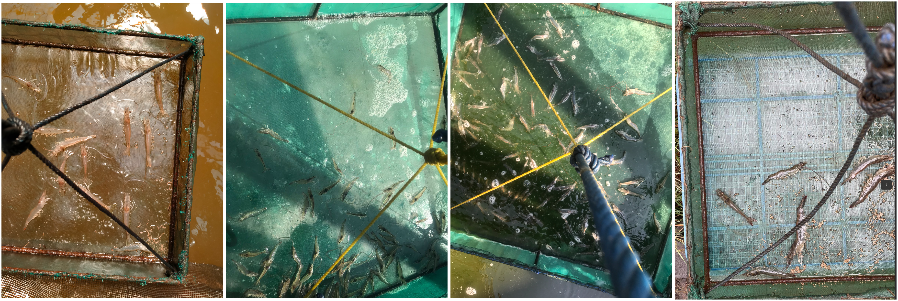

# Smart-Farming Shrimp Growth Monitoring

An AI-assisted smart-farming system for shrimp detection, length estimation, and average weight prediction using smartphone images collected under real farm conditions.

## Research Overview

The system integrates:

- Shrimp detection using YOLOv8
- Reference-based length estimation
- Average shrimp weight prediction
- Smartphone-based result visualization

## Shrimp Detection

YOLOv8 is used to detect whiteleg shrimp (*Litopenaeus vannamei*) in smartphone images.

| Metric | Result |
|---|---:|
| Precision | 0.988 |
| Recall | 0.927 |
| mAP@0.5 | 0.982 |
| mAP@0.5:0.95 | 0.877 |

The detector was evaluated using 280 separate testing images.

## Length Estimation

For each detected shrimp:

P_shrimp = max(box_width, box_height)

Shrimp Length = (P_shrimp / P_reference) × L_reference

| Metric | Result |
|---|---:|
| MAE | 1.54 cm |
| RMSE | 1.63 cm |
| MAPE | 14.6% |

Evaluation was performed using 29 separate real-farm images.

## Weight Estimation

Average shrimp weight is estimated using image-level features derived from detected shrimp regions.

### GBR Results

| Metric | Result |
|---|---:|
| MAE | 0.44 g |
| RMSE | 0.61 g |
| MAPE | 3.9% |

Evaluation was performed using 26 real-farm weight images.

## Research Figures

### System Overview

### Farm Image Examples

## Mobile Application

The research prototype integrates image input, shrimp detection, reference calibration, length estimation, weight estimation, and result visualization on a smartphone.

## Dataset Summary

| Dataset | Images |
|---|---:|
| Detection training | 6,350 |
| Detection testing | 280 |
| Length evaluation | 29 |
| Weight evaluation | 26 |

## Availability

Source code, trained models, model weights, annotations, and research datasets are not publicly distributed.

This repository presents publicly shareable research methodology, figures, and experimental results only.
